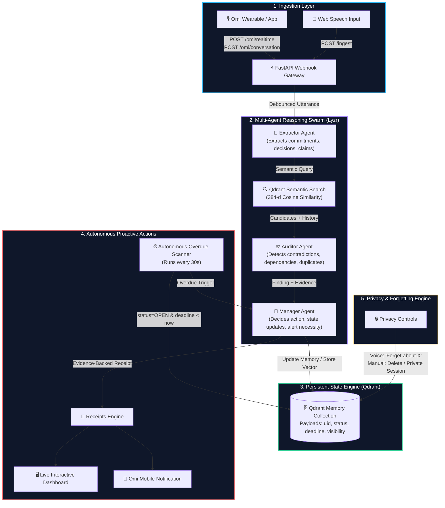

# Receipts

> **Your memory for what you said, decided, and promised.**  
> *Autonomous voice memory that listens through Omi, persists semantic commitments in Qdrant, reasons across time using Lyzr multi-agent swarms, and proactively issues evidence-backed receipts when promises conflict or expire.*

---

## 🏆 Hackathon Submission Details

- **Hackathon:** The Dawn of the Autonomous AI Builder
- **Organizers:** Lyzr × Qdrant × Omi
- **Mandatory Stack Integrated:**
  - **Omi:** Continuous voice stream ingestion via webhooks & phone push notifications
  - **Qdrant:** Persistent vector database with semantic retrieval and metadata state filtering
  - **Lyzr:** Multi-agent reasoning swarm (**Extractor** ➔ **Auditor** ➔ **Manager**) and Superflows

---

## 💡 The Problem

In high-velocity teams, founder meetings, and client calls:
- People promise deadlines they later forget.
- Technical decisions made on Monday get quietly contradicted on Thursday.
- Blockers stay unresolved while new commitments are piled on top of them.

Traditional AI note-takers require the user to actively ask:  
*"Did I promise something about the API earlier?"*

That is **reactive**, not autonomous.

## 🚀 The Solution: Receipts

Receipts is an **autonomous guardian of team memory**. It continuously listens through your Omi wearable or meeting audio, tracks the state of your commitments and decisions in Qdrant, and **proactively interrupts you** when:
1. You contradict a decision made earlier.
2. You promise to ship something that is blocked by an unresolved dependency.
3. An open commitment passes its deadline without being fulfilled.
4. A decision changes and supersedes past architectural consensus.

Every alert is an **evidence-backed Receipt** displaying what was said, the historical evidence retrieved from Qdrant, and the agent's confidence score.

---

## ⚡ The Autonomous Execution Loop

```
Omi Voice Input
      ↓ (Continuous webhook / HTTP 200 fast response)
FastAPI Webhook Gateway
      ↓ (Async task queue)
1. Lyzr Extractor Agent  ──▶ Identifies commitments, decisions, claims, commands
      ↓
2. Qdrant Vector Engine  ──▶ Semantic similarity search across historical payload states
      ↓
3. Lyzr Auditor Agent    ──▶ Conservative reasoning: contradiction? blocker? duplicate?
      ↓
4. Lyzr Manager Agent    ──▶ Policy decision: alert? update status? rate limit?
      ↓
Deterministic Code Guards──▶ Validates state machine (OPEN/BLOCKED/DONE), confidence floor (>=0.70)
      ↓
Autonomous Receipt Engine──▶ Proactive alert on Dashboard + Push notification to Omi app
```

---

## 🏛️ System Architecture



---

## 🤖 The Three Specialized Agents

| Agent | Technology | Prompt Specification | Responsibility |
|---|---|---|---|
| **1. Extractor** | Lyzr Agent API | `prompts/extractor.md` | Parses spoken transcripts into structured primitives: commitments, decisions, claims, and privacy commands. Ignores conversational filler. |
| **2. Auditor** | Lyzr Agent API | `prompts/auditor.md` | Compares new candidate statements against Qdrant semantic memories. Employs conservative reasoning to flag contradictions, changed decisions, and blocker dependencies. Cites evidence. |
| **3. Manager** | Lyzr Agent API | `prompts/manager.md` | Chief coordinator and decision-maker. Enforces anti-spam policy, determines whether to generate an alert, and specifies memory state transitions. |

### Deterministic Safety Code Guards
LLMs must never corrupt database state. Strict Python code guards wrap all agent outputs:
- **State Machine Enforcement:** Only valid state transitions are applied (Commitments: `OPEN` ➔ `BLOCKED` ➔ `DONE`; Decisions: `ACTIVE` ➔ `SUPERSEDED`; Claims: `CURRENT` ➔ `RESOLVED`).
- **Confidence Floor:** Alerts with auditor confidence below `0.70` are suppressed.
- **Deduplication & Rate Limiting:** Maximum 10 alerts per user per hour; duplicate findings are ignored.

---

## 🗄️ Qdrant Memory Model

Qdrant acts as an actual persistent state engine:
- **Vectors:** 384-dimensional dense vectors generated via `fastembed` (`BAAI/bge-small-en-v1.5`) locally or Qdrant Cloud.
- **Payload Schema:**
  - `uid`: User or speaker identifier
  - `memory_id`: Unique point UUID
  - `kind`: `commitment` \| `decision` \| `claim`
  - `subject`: Normalized topic (e.g., `authentication`, `database`, `api`)
  - `status`: `OPEN`, `BLOCKED`, `DONE`, `ACTIVE`, `SUPERSEDED`, `CURRENT`, `RESOLVED`
  - `speaker`: Person responsible
  - `deadline_iso`, `deadline_ts`, `deadline_phrase`: Absolute and relative time tracking
  - `polarity`: `positive` \| `negative` (for claim/blocker tracking)
  - `visibility`: `personal` \| `private` (private items are excluded from agent retrieval)
  - `created_at`, `updated_at`: ISO timestamps

---

## 🧾 The Four Core Receipt Types

1. **Commitment Receipt**  
   *"I'll finish the API integration by Friday."* ➔ Tracked in Qdrant with `OPEN` status and calculated deadline timestamp.
2. **Decision Receipt**  
   *"We're going with PostgreSQL for the database."* ➔ Tracked as `ACTIVE`. If the user later says *"We're going with MongoDB"*, a **Decision Changed** receipt is generated and PostgreSQL is marked `SUPERSEDED`.
3. **Contradiction / Conflict Receipt**  
   *"We're still blocked because auth isn't ready"* after earlier stating *"Authentication is fixed now"*. ➔ Proactive warning with evidence citation and confidence score.
4. **Autonomous Overdue Receipt**  
   Autonomous background worker scans Qdrant every 30 seconds. When `status == "OPEN"` and `deadline < now`, an overdue receipt is issued without any user prompting.

---

## 🔒 Privacy & Forgetting Controls

Privacy is an active product feature, not marketing copy:
- **Voice Forgetting:** Saying *"Receipts, forget what I said about authentication"* searches Qdrant and wipes all related memories.
- **Time-Window Forgetting:** Saying *"Receipts, forget the last 15 minutes"* deletes memories created in that time window.
- **Private Sessions:** Saying *"Don't remember this conversation"* enables incognito mode where incoming speech is completely ignored until *"resume"* is spoken.
- **Private Visibility:** Memories flagged as private are filtered out via Qdrant's payload filters (`must_not: visibility=private`) and never surfaced to agents.

---

## 🎬 Deterministic Hackathon Demo Walkthrough

The built-in dashboard features a 1-click **Judge Walkthrough Controller** executing the exact 5-day story:

1. **Day 1 — Promise:**  
   *"I'll finish the authentication API by Friday."*  
   ➔ Extractor detects commitment, Qdrant records `OPEN` status.
2. **Day 2 — Decision:**  
   *"Let's use PostgreSQL for the database."*  
   ➔ Qdrant stores `ACTIVE` decision.
3. **Day 3 — Blocker Dependency:**  
   *"The authentication API is blocking our demo."*  
   ➔ Auditor links to Day 1 commitment, Manager transitions its status to `BLOCKED`.
4. **Day 4 — Blocker Resolution:**  
   *"Authentication is fixed now."*  
   ➔ Claim resolved, commitment transitions back to `OPEN`/unblocked.
5. **Day 5 — Contradiction Alert:**  
   *"We're still blocked because authentication isn't ready."*  
   ➔ Auditor detects conflict with Day 4 resolution, Manager issues a **Possible Contradiction Receipt** citing historical evidence.
6. **Privacy Wipe:**  
   *"Receipts, forget about authentication"*  
   ➔ Immediate semantic deletion from Qdrant, verified live in the Memory Vault.

---

## 🛠️ Quickstart & Local Setup

### 1. Clone & Install
```bash
git clone https://github.com/Dhanishka-CK/Receipts.git
cd Receipts
python -m venv venv
# Windows:
.\venv\Scripts\activate
# Linux/macOS:
source venv/bin/activate

pip install -r requirements.txt
```

### 2. Configure Environment
```bash
cp .env.example .env
```
Leave keys empty to run the built-in deterministic agent simulator (**MOCK_AGENTS=auto**), or add your real keys:
- `LYZR_API_KEY`, `LYZR_EXTRACTOR_AGENT_ID`, `LYZR_AUDITOR_AGENT_ID`, `LYZR_MANAGER_AGENT_ID`
- `QDRANT_URL`, `QDRANT_API_KEY` (or leave empty for local embedded storage)
- `OMI_APP_ID`, `OMI_APP_SECRET` (optional, for mobile phone notifications)

### 3. Run Locally
```bash
uvicorn receipts.main:app --reload --port 8000
```
Open [http://localhost:8000](http://localhost:8000) to view the live dashboard.

---

## 🧪 Testing

Receipts includes a test suite covering all 15 hackathon requirements:
- Memory extraction & classification
- Qdrant vector storage & semantic retrieval
- Contradiction & conflict reasoning
- Decision superseding logic
- Commitment state transitions (`OPEN` ➔ `BLOCKED` ➔ `DONE`)
- Autonomous overdue scheduler
- Privacy topic & time-window deletion
- Rate limiting & deduplication
- Omi payload normalization & malformed inputs
- Lyzr API parsing & error handling
- REST API validation models
- Full 5-day judge story

Run all 33 tests:
```bash
pytest -v
```

---

## 📊 Agent Performance & Telemetry Engine

Built to directly address the hackathon's scoring focus on **Agent Performance, Latency, and Hallucination Suppression**:
- **Millisecond Latency Profiling:** Precise percentiles (p50, p95, avg) for the Extractor, Qdrant Vector Retrieval, Auditor, and Manager.
- **Hallucination Verification Guard:** Cryptographically verifies every agent citation against Qdrant Vector IDs before an alert can be issued. Phantom target IDs are immediately intercepted and suppressed.
- **Knowledge Base RAG Grounding:** Lyzr agents are grounded in `TEAM_COMMITMENT_PLAYBOOK.md` to enforce organizational SLAs, database standards, and conflict escalation rules.
- **Qdrant Agentic Memory Tools:** Formal tool layer providing `search_working_memory()`, `update_memory_state()`, `scan_temporal_deadlines()`, and `recall_speaker_history()`.

---

## 🌐 Production Deployment

### Option A: Render (1-Click)
A complete `render.yaml` blueprint is included. Simply link your GitHub repository to Render and deploy.

### Option B: Docker
```bash
docker build -t receipts .
docker run -p 8000:8000 --env-file .env receipts
```

### Option C: Docker Compose (with Qdrant Service)
```bash
docker-compose up --build
```

---

## 📡 API Reference

| Method | Endpoint | Description |
|---|---|---|
| `GET` | `/health` | Healthcheck verifying Qdrant connection, Lyzr status, and embeddings |
| `GET` | `/status` | Comprehensive system telemetry and component metrics |
| `GET` | `/metrics` | Detailed multi-agent latency percentiles (p50/p95), hallucination rate, and telemetry |
| `POST` | `/omi/realtime` | Omi realtime speech chunks webhook |
| `POST` | `/omi/conversation` | Omi conversation completed webhook |
| `POST` | `/ingest` | Process speech or text input through full autonomous pipeline |
| `POST` | `/ask` | Grounded semantic Q&A over memory vault |
| `GET` | `/memories` | List all memories for a user (optional `kind` filter) |
| `GET` | `/commitments` | List open/blocked/completed commitments |
| `GET` | `/decisions` | List active/superseded decisions |
| `DELETE` | `/memories/{id}` | Delete a specific memory point |
| `GET` | `/receipts` | List evidence-backed proactive receipts |
| `POST` | `/alerts/{id}/resolve` | Mark an alert resolved and update memory state |
| `POST` | `/forget` | Privacy action to forget by topic or time window |
| `GET` | `/trace` | Live observable agent execution trace events |
| `POST` | `/demo/step` | Run specific step (1-6) of the judge demo scenario |
| `POST` | `/demo/overdue-check` | Trigger autonomous overdue scheduler check |

