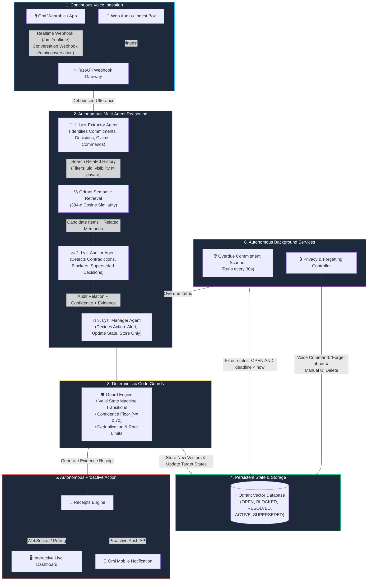
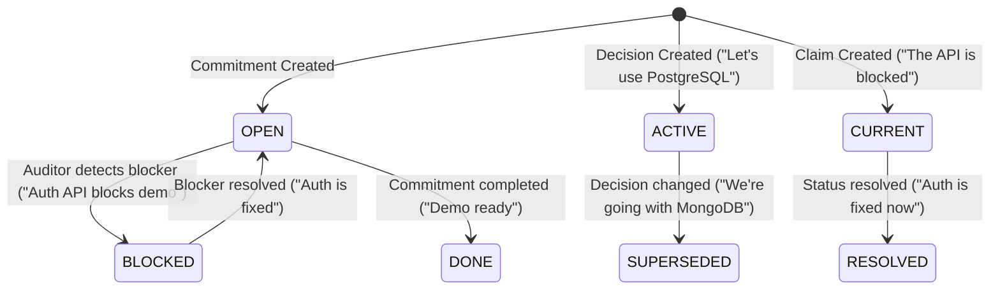

# Receipts Architecture Specification

---

## 1. Core Technological Integration

Receipts genuinely leverages the hackathon's three mandatory technologies:

1. **Omi (Continuous Voice Input & Notifications)**
   - Real-time transcript chunks and completed conversation summaries arrive through `/omi/realtime` and `/omi/conversation`.
   - Normalization layer handles varied schema shapes and extracts user identity (`uid`).
   - Non-blocking architecture: returns HTTP 200 within <20ms while processing heavy reasoning asynchronously.
   - When supported, evidence-backed receipts are pushed directly back to the user's phone via the Omi Notification API.

2. **Qdrant (Persistent Vector Memory & State Engine)**
   - Single vector collection (`receipts_memory`) with 384-dimensional cosine distance vectors (`BAAI/bge-small-en-v1.5`).
   - Semantic retrieval finds historically related commitments, decisions, and blockers even across days or semantic phrasing shifts.
   - Rich payload metadata tracking: `uid`, `memory_id`, `kind`, `subject`, `status`, `speaker`, `deadline_iso`, `deadline_ts`, `polarity`, `visibility`, `created_at`, `updated_at`, `confidence`.
   - Memory survives application restarts (via Qdrant Cloud or persistent embedded volume).

3. **Lyzr (Specialized Multi-Agent Swarm)**
   - **Extractor Agent**: Extracts structured primitives (`commitment`, `decision`, `claim`, `command`).
   - **Auditor Agent**: Reasons over new statements against retrieved vector memories to detect contradictions, blocker dependencies, and duplicate commitments.
   - **Manager Agent**: Coordinates policy, enforces conservative alerting, prevents alert spam, and instructs state changes.

---

## 2. Memory State Machine

Memory items evolve over time rather than remaining static text rows:

---

## 3. Privacy & Forgetting Architecture

Privacy is built directly into vector retrieval:
- **Private Sessions**: When "Don't remember this conversation" is detected, incoming utterances are completely ignored until "resume" is spoken.
- **Private Memories**: Memories tagged `visibility: "private"` are excluded at the Qdrant filter level (`must_not: visibility=private`).
- **Selective Forgetting**: "Forget what I said about X" executes semantic search and deletes matching vector points without deleting unrelated commitments.
